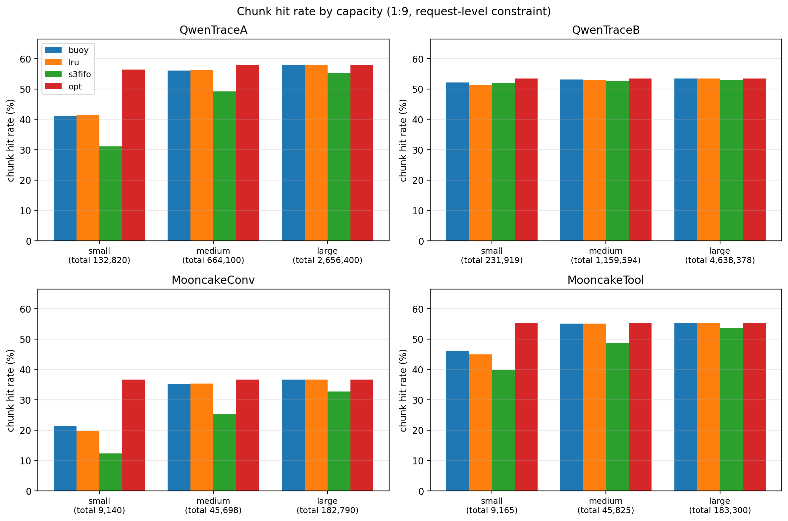
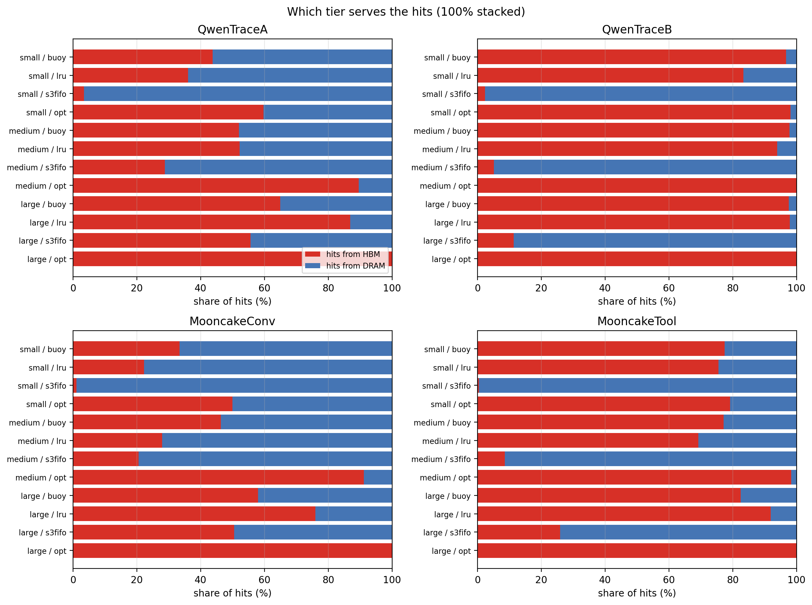
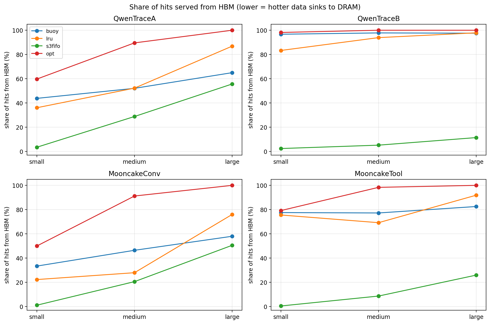
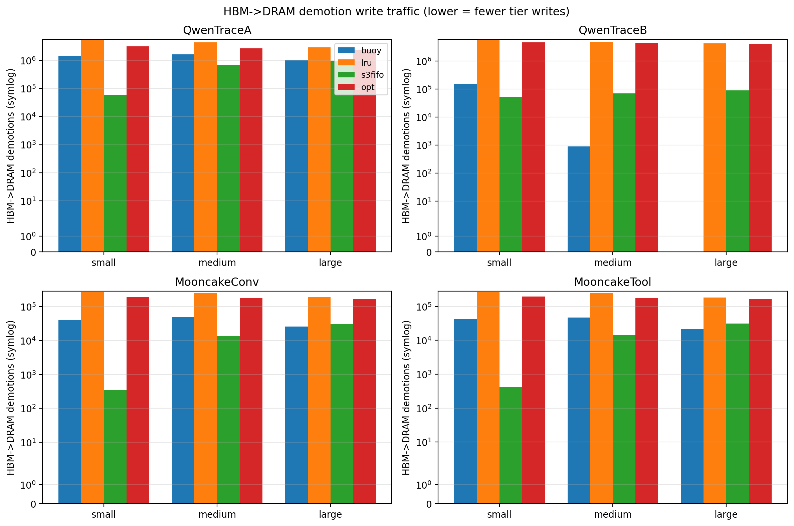
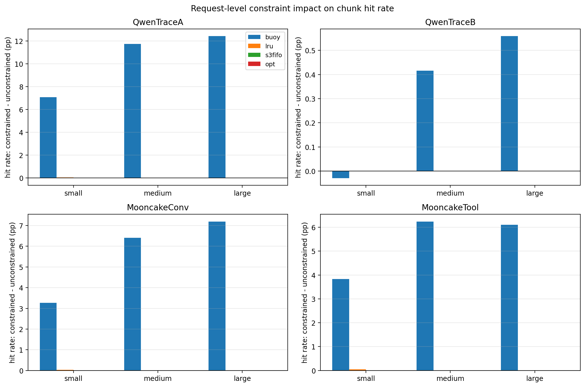

# HBM:DRAM = 1:9 分层前缀缓存命中率报告

- **算法**:Buoy / LRU / S3-FIFO(`buoy_sim/policies.py`)
- **分层比例**:HBM:DRAM = 1:9(S3-FIFO 中 HBM 充当 small FIFO,DRAM 充当 main FIFO)
- **ghost 容量**:4×HBM(buoy 与 s3fifo 使用;LRU 无 ghost)
- **容量点**:small / medium / large = 5% / 25% / 100% × 各轨迹唯一块工作集 W
- **重放语义**:1 个模拟 chunk = 1 个 hash 块(Qwen 16 真实 token/块,Mooncake ≈500 token/块),`block_size=1`
- **请求级约束(主结果)**:请求处理期间其全部 chunk 免于驱逐(层间迁移允许),缺失 chunk 强制准入(Buoy 深度准入失效);N > 总容量的请求豁免并计入 constraint_waived。报告同时给出无约束基线对比(见 §3)
- **OPT(Belady MIN)**:离线最优基线——对总容量(hbm+dram)做严格 MIN 驱逐,oracle 贪心分层(HBM 优先持有下次访问最早的 chunk,只拉不推近似);命中率为同容量所有策略的理论上界
- **到达顺序**:文件序(已验证 4 条轨迹时间戳单调)
- **原始数据**:`tier_1to9_summary.csv`(含全部机制统计:demotions / evictions / ghost_hits / second_chances 等)

## 1. 轨迹概况

| 轨迹 | 请求数 | 块访问数 | 唯一块 W |
|---|---|---|---|
| QwenTraceA | 43,058 | 6,293,976 | 2,656,400 |
| QwenTraceB | 172,800 | 9,956,137 | 4,638,378 |
| MooncakeConv | 12,031 | 288,500 | 182,790 |
| MooncakeTool | 23,608 | 409,616 | 183,300 |

## 2. 总块命中率(chunk hit rate)

| 轨迹 | 容量点 | 总容量 | Buoy | LRU | S3-FIFO | OPT |
|---|---|---|---|---|---|---|
| QwenTraceA | small | 132,820 | 40.96% | 41.32% | 31.08% | 56.46% |
| QwenTraceA | medium | 664,100 | 56.03% | 56.23% | 49.21% | 57.79% |
| QwenTraceA | large | 2,656,400 | 57.79% | 57.79% | 55.36% | 57.79% |
| QwenTraceB | small | 231,919 | 52.20% | 51.29% | 51.95% | 53.41% |
| QwenTraceB | medium | 1,159,594 | 53.18% | 53.01% | 52.60% | 53.41% |
| QwenTraceB | large | 4,638,378 | 53.41% | 53.41% | 53.02% | 53.41% |
| MooncakeConv | small | 9,140 | 21.25% | 19.57% | 12.28% | 36.64% |
| MooncakeConv | medium | 45,698 | 35.17% | 35.35% | 25.15% | 36.64% |
| MooncakeConv | large | 182,790 | 36.64% | 36.64% | 32.77% | 36.64% |
| MooncakeTool | small | 9,165 | 46.20% | 44.99% | 39.81% | 55.25% |
| MooncakeTool | medium | 45,825 | 55.13% | 55.09% | 48.68% | 55.25% |
| MooncakeTool | large | 183,300 | 55.25% | 55.25% | 53.71% | 55.25% |

## 3. 请求级约束 vs 无约束(总块命中率)

约束语义:请求处理期间其全部 chunk 免于驱逐(层间迁移允许),缺失 chunk 强制准入;N > 总容量的请求豁免。

| 轨迹 | 容量点 | 策略 | 无约束 | 有约束 | Δ (pp) |
|---|---|---|---|---|---|
| QwenTraceA | small | buoy | 33.90% | 40.96% | +7.06 |
| QwenTraceA | small | lru | 41.28% | 41.32% | +0.04 |
| QwenTraceA | small | s3fifo | 31.08% | 31.08% | -0.00 |
| QwenTraceA | small | opt | 56.47% | 56.46% | -0.02 |
| QwenTraceA | medium | buoy | 44.29% | 56.03% | +11.74 |
| QwenTraceA | medium | lru | 56.23% | 56.23% | +0.00 |
| QwenTraceA | medium | s3fifo | 49.21% | 49.21% | +0.00 |
| QwenTraceA | medium | opt | 57.79% | 57.79% | +0.00 |
| QwenTraceA | large | buoy | 45.36% | 57.79% | +12.43 |
| QwenTraceA | large | lru | 57.79% | 57.79% | +0.00 |
| QwenTraceA | large | s3fifo | 55.36% | 55.36% | +0.00 |
| QwenTraceA | large | opt | 57.79% | 57.79% | +0.00 |
| QwenTraceB | small | buoy | 52.23% | 52.20% | -0.03 |
| QwenTraceB | small | lru | 51.29% | 51.29% | +0.00 |
| QwenTraceB | small | s3fifo | 51.95% | 51.95% | +0.00 |
| QwenTraceB | small | opt | 53.41% | 53.41% | +0.00 |
| QwenTraceB | medium | buoy | 52.77% | 53.18% | +0.42 |
| QwenTraceB | medium | lru | 53.01% | 53.01% | +0.00 |
| QwenTraceB | medium | s3fifo | 52.60% | 52.60% | +0.00 |
| QwenTraceB | medium | opt | 53.41% | 53.41% | +0.00 |
| QwenTraceB | large | buoy | 52.85% | 53.41% | +0.56 |
| QwenTraceB | large | lru | 53.41% | 53.41% | +0.00 |
| QwenTraceB | large | s3fifo | 53.02% | 53.02% | +0.00 |
| QwenTraceB | large | opt | 53.41% | 53.41% | +0.00 |
| MooncakeConv | small | buoy | 17.98% | 21.25% | +3.27 |
| MooncakeConv | small | lru | 19.54% | 19.57% | +0.03 |
| MooncakeConv | small | s3fifo | 12.28% | 12.28% | +0.00 |
| MooncakeConv | small | opt | 36.64% | 36.64% | +0.00 |
| MooncakeConv | medium | buoy | 28.77% | 35.17% | +6.40 |
| MooncakeConv | medium | lru | 35.35% | 35.35% | +0.00 |
| MooncakeConv | medium | s3fifo | 25.15% | 25.15% | +0.00 |
| MooncakeConv | medium | opt | 36.64% | 36.64% | +0.00 |
| MooncakeConv | large | buoy | 29.45% | 36.64% | +7.19 |
| MooncakeConv | large | lru | 36.64% | 36.64% | +0.00 |
| MooncakeConv | large | s3fifo | 32.77% | 32.77% | +0.00 |
| MooncakeConv | large | opt | 36.64% | 36.64% | +0.00 |
| MooncakeTool | small | buoy | 42.37% | 46.20% | +3.83 |
| MooncakeTool | small | lru | 44.94% | 44.99% | +0.05 |
| MooncakeTool | small | s3fifo | 39.81% | 39.81% | +0.00 |
| MooncakeTool | small | opt | 55.25% | 55.25% | +0.00 |
| MooncakeTool | medium | buoy | 48.89% | 55.13% | +6.24 |
| MooncakeTool | medium | lru | 55.09% | 55.09% | +0.00 |
| MooncakeTool | medium | s3fifo | 48.68% | 48.68% | +0.00 |
| MooncakeTool | medium | opt | 55.25% | 55.25% | +0.00 |
| MooncakeTool | large | buoy | 49.15% | 55.25% | +6.11 |
| MooncakeTool | large | lru | 55.25% | 55.25% | +0.00 |
| MooncakeTool | large | s3fifo | 53.71% | 53.71% | +0.00 |
| MooncakeTool | large | opt | 55.25% | 55.25% | +0.00 |

## 4. HBM / DRAM 命中分布(有约束)

命中率 = 该层命中数 / 总块访问数;命中份额 = 该层命中数 / 全部命中(两者之和为 100%)。

### QwenTraceA

| 容量点 | 策略 | HBM 命中率 | DRAM 命中率 | 命中来自 HBM | 命中来自 DRAM |
|---|---|---|---|---|---|
| small | buoy | 17.93% | 23.04% | 43.76% | 56.24% |
| small | lru | 14.89% | 26.43% | 36.03% | 63.97% |
| small | s3fifo | 1.07% | 30.02% | 3.43% | 96.57% |
| small | opt | 33.70% | 22.76% | 59.69% | 40.31% |
| medium | buoy | 29.17% | 26.87% | 52.05% | 47.95% |
| medium | lru | 29.36% | 26.87% | 52.22% | 47.78% |
| medium | s3fifo | 14.17% | 35.04% | 28.79% | 71.21% |
| medium | opt | 51.76% | 6.04% | 89.55% | 10.45% |
| large | buoy | 37.56% | 20.24% | 64.98% | 35.02% |
| large | lru | 50.21% | 7.59% | 86.87% | 13.13% |
| large | s3fifo | 30.80% | 24.56% | 55.64% | 44.36% |
| large | opt | 57.79% | 0.00% | 100.00% | 0.00% |

### QwenTraceB

| 容量点 | 策略 | HBM 命中率 | DRAM 命中率 | 命中来自 HBM | 命中来自 DRAM |
|---|---|---|---|---|---|
| small | buoy | 50.48% | 1.72% | 96.70% | 3.30% |
| small | lru | 42.73% | 8.56% | 83.32% | 16.68% |
| small | s3fifo | 1.23% | 50.72% | 2.36% | 97.64% |
| small | opt | 52.43% | 0.98% | 98.17% | 1.83% |
| medium | buoy | 52.01% | 1.17% | 97.79% | 2.21% |
| medium | lru | 49.78% | 3.23% | 93.91% | 6.09% |
| medium | s3fifo | 2.71% | 49.89% | 5.15% | 94.85% |
| medium | opt | 53.41% | 0.00% | 100.00% | 0.00% |
| large | buoy | 52.10% | 1.31% | 97.54% | 2.46% |
| large | lru | 52.28% | 1.14% | 97.87% | 2.13% |
| large | s3fifo | 6.04% | 46.98% | 11.39% | 88.61% |
| large | opt | 53.41% | 0.00% | 100.00% | 0.00% |

### MooncakeConv

| 容量点 | 策略 | HBM 命中率 | DRAM 命中率 | 命中来自 HBM | 命中来自 DRAM |
|---|---|---|---|---|---|
| small | buoy | 7.09% | 14.16% | 33.36% | 66.64% |
| small | lru | 4.35% | 15.22% | 22.25% | 77.75% |
| small | s3fifo | 0.13% | 12.15% | 1.08% | 98.92% |
| small | opt | 18.30% | 18.34% | 49.95% | 50.05% |
| medium | buoy | 16.32% | 18.85% | 46.40% | 53.60% |
| medium | lru | 9.86% | 25.48% | 27.90% | 72.10% |
| medium | s3fifo | 5.16% | 19.99% | 20.53% | 79.47% |
| medium | opt | 33.42% | 3.22% | 91.21% | 8.79% |
| large | buoy | 21.24% | 15.40% | 57.98% | 42.02% |
| large | lru | 27.84% | 8.80% | 75.98% | 24.02% |
| large | s3fifo | 16.55% | 16.21% | 50.52% | 49.48% |
| large | opt | 36.64% | 0.00% | 100.00% | 0.00% |

### MooncakeTool

| 容量点 | 策略 | HBM 命中率 | DRAM 命中率 | 命中来自 HBM | 命中来自 DRAM |
|---|---|---|---|---|---|
| small | buoy | 35.82% | 10.38% | 77.53% | 22.47% |
| small | lru | 33.98% | 11.01% | 75.53% | 24.47% |
| small | s3fifo | 0.18% | 39.63% | 0.45% | 99.55% |
| small | opt | 43.75% | 11.50% | 79.19% | 20.81% |
| medium | buoy | 42.57% | 12.56% | 77.21% | 22.79% |
| medium | lru | 38.11% | 16.97% | 69.19% | 30.81% |
| medium | s3fifo | 4.20% | 44.48% | 8.63% | 91.37% |
| medium | opt | 54.34% | 0.91% | 98.36% | 1.64% |
| large | buoy | 45.60% | 9.65% | 82.53% | 17.47% |
| large | lru | 50.77% | 4.48% | 91.88% | 8.12% |
| large | s3fifo | 13.92% | 39.79% | 25.92% | 74.08% |
| large | opt | 55.25% | 0.00% | 100.00% | 0.00% |

## 5. 缓存机制统计(medium 容量点,有约束)

| 轨迹 | 策略 | 准入 | 拒绝 | HBM→DRAM 降配 | 淘汰 | ghost 命中 | 二次机会 | 约束豁免 |
|---|---|---|---|---|---|---|---|---|
| QwenTraceA | buoy | 2,767,316 | 0 | 1,624,573 | 2,103,216 | 64,126 | 950,857 | 0 |
| QwenTraceA | lru | 2,754,841 | 0 | 4,379,601 | 2,090,741 | 0 | 0 | 0 |
| QwenTraceA | s3fifo | 3,196,546 | 0 | 686,115 | 2,532,446 | 461,369 | 474,223 | 0 |
| QwenTraceA | opt | 2,656,400 | 0 | 2,694,687 | 1,992,300 | 0 | 0 | 0 |
| QwenTraceB | buoy | 4,660,991 | 0 | 891 | 3,501,397 | 7,916 | 3,184 | 0 |
| QwenTraceB | lru | 4,678,155 | 0 | 4,883,744 | 3,518,561 | 0 | 0 | 0 |
| QwenTraceB | s3fifo | 4,719,691 | 0 | 69,176 | 4,496,494 | 38,062 | 0 | 0 |
| QwenTraceB | opt | 4,638,378 | 0 | 4,502,038 | 3,478,784 | 0 | 0 | 0 |
| MooncakeConv | buoy | 187,026 | 0 | 49,823 | 141,328 | 2,103 | 30,154 | 0 |
| MooncakeConv | lru | 186,522 | 0 | 255,474 | 140,824 | 0 | 0 | 0 |
| MooncakeConv | s3fifo | 215,940 | 0 | 13,582 | 173,119 | 24,669 | 0 | 0 |
| MooncakeConv | opt | 182,790 | 0 | 176,902 | 137,092 | 0 | 0 | 0 |
| MooncakeTool | buoy | 183,797 | 0 | 46,879 | 137,972 | 201 | 27,474 | 0 |
| MooncakeTool | lru | 183,970 | 0 | 248,915 | 138,145 | 0 | 0 | 0 |
| MooncakeTool | s3fifo | 210,234 | 0 | 14,093 | 168,091 | 23,468 | 0 | 0 |
| MooncakeTool | opt | 183,300 | 0 | 176,087 | 137,475 | 0 | 0 | 0 |

## 6. 对比图

## 7. 观察与结论

- **QwenTraceA/small**:OPT(约束下)56.46%;在线最佳 41.32%(by lru),距最优 15.13 pp;S3-FIFO 为 OPT(约束下)的 55.1%,其命中 96.57% 来自 DRAM
- **QwenTraceA/medium**:OPT(约束下)57.79%;在线最佳 56.23%(by lru),距最优 1.56 pp;S3-FIFO 为 OPT(约束下)的 85.2%,其命中 71.21% 来自 DRAM
- **QwenTraceA/large**:OPT(约束下)57.79%;在线最佳 57.79%(by buoy),距最优 0.00 pp;S3-FIFO 为 OPT(约束下)的 95.8%,其命中 44.36% 来自 DRAM
- **QwenTraceB/small**:OPT(约束下)53.41%;在线最佳 52.20%(by buoy),距最优 1.21 pp;S3-FIFO 为 OPT(约束下)的 97.3%,其命中 97.64% 来自 DRAM
- **QwenTraceB/medium**:OPT(约束下)53.41%;在线最佳 53.18%(by buoy),距最优 0.23 pp;S3-FIFO 为 OPT(约束下)的 98.5%,其命中 94.85% 来自 DRAM
- **QwenTraceB/large**:OPT(约束下)53.41%;在线最佳 53.41%(by lru),距最优 0.00 pp;S3-FIFO 为 OPT(约束下)的 99.3%,其命中 88.61% 来自 DRAM
- **MooncakeConv/small**:OPT(约束下)36.64%;在线最佳 21.25%(by buoy),距最优 15.39 pp;S3-FIFO 为 OPT(约束下)的 33.5%,其命中 98.92% 来自 DRAM
- **MooncakeConv/medium**:OPT(约束下)36.64%;在线最佳 35.35%(by lru),距最优 1.29 pp;S3-FIFO 为 OPT(约束下)的 68.6%,其命中 79.47% 来自 DRAM
- **MooncakeConv/large**:OPT(约束下)36.64%;在线最佳 36.64%(by buoy),距最优 0.00 pp;S3-FIFO 为 OPT(约束下)的 89.4%,其命中 49.48% 来自 DRAM
- **MooncakeTool/small**:OPT(约束下)55.25%;在线最佳 46.20%(by buoy),距最优 9.05 pp;S3-FIFO 为 OPT(约束下)的 72.0%,其命中 99.55% 来自 DRAM
- **MooncakeTool/medium**:OPT(约束下)55.25%;在线最佳 55.13%(by buoy),距最优 0.12 pp;S3-FIFO 为 OPT(约束下)的 88.1%,其命中 91.37% 来自 DRAM
- **MooncakeTool/large**:OPT(约束下)55.25%;在线最佳 55.25%(by buoy),距最优 0.00 pp;S3-FIFO 为 OPT(约束下)的 97.2%,其命中 74.08% 来自 DRAM

- **HBM→DRAM 降配流量**(medium,4 轨迹求和):LRU 9,767,734,Buoy 1,722,166,S3-FIFO 782,966,OPT(oracle) 7,549,714;S3-FIFO 仅为 LRU 的 8.0%
- **命中热度的分层分布**(medium 平均):Buoy 命中的 68.36% 落在 HBM,LRU 60.80%,S3-FIFO 仅 15.78%,OPT 的 oracle 放置为 94.78%(HBM 命中份额的上界)—— S3-FIFO 把 HBM 当作短试用期,热点迅速沉淀到 DRAM,HBM 写流量随之最小化
- **Buoy 的深度准入**在无约束 medium 点共拒绝 5,214,680 个 chunk;请求级约束下强制准入使其失效(有约束时拒绝数为 0),一次性访问随之进入缓存
- **约束的平均命中率变化**(medium,4 轨迹平均):buoy +6.20 pp, lru +0.00 pp, s3fifo +0.00 pp, opt +0.00 pp(负值 = 约束限制了受害者选择并引入强制准入的代价)

注 1:OPT 的 demotion 为 oracle 换入换出流量(每次 DRAM 命中至多触发一次),与在线策略“溢出时降配”的口径不同,算法间比较以命中率与分层命中份额为主。
注 2:约束模式下 OPT 不再是严格 MIN 上界(pin 限制受害者选择 + 强制准入偏离纯 MIN),无约束 OPT(§3)仍为全局命中率上界。
